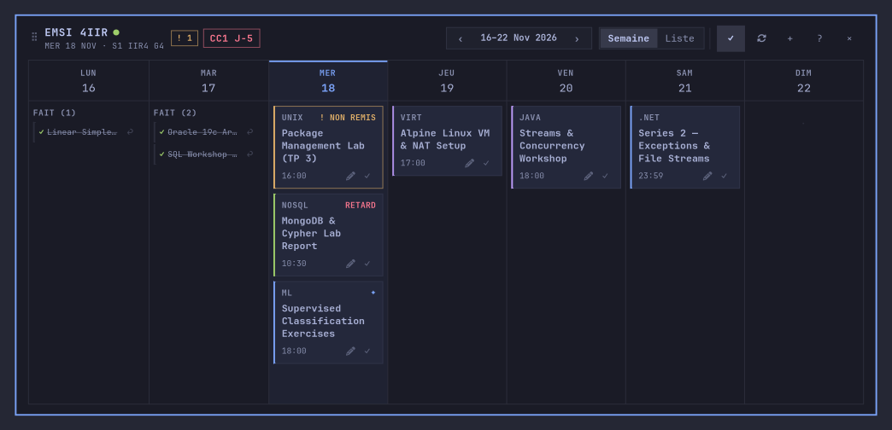
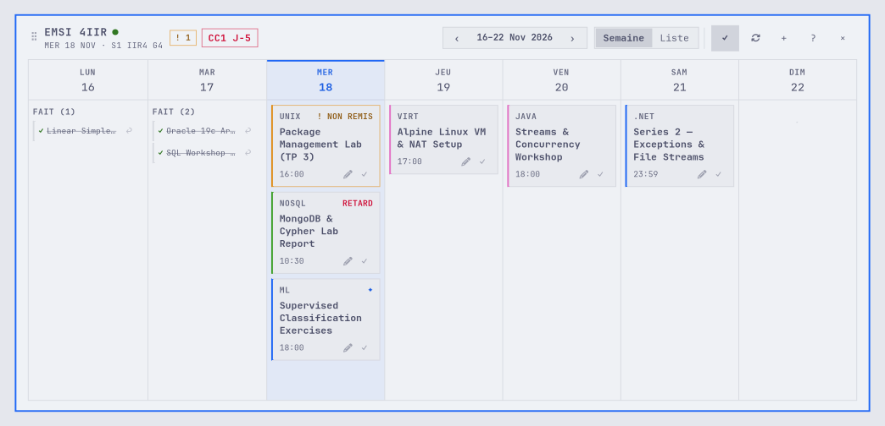
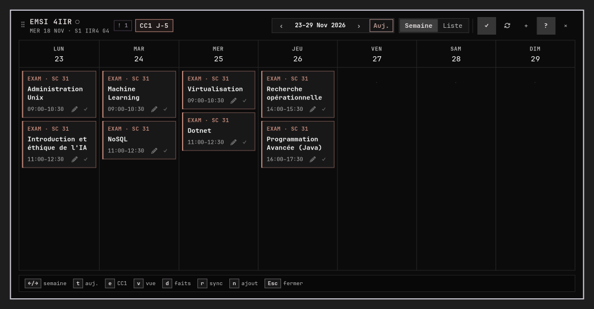
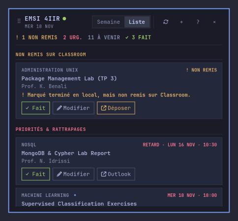

# school-plan

An Omarchy-native desktop academic planner for Hyprland (GTK4 + `gtk4-layer-shell`) with live theme synchronization, read-only Google Classroom & Outlook Web harvesting, local Gemma 4 enrichment via LM Studio, and RFC 5545 `.ics` calendar export.



## Highlights

- **Live Omarchy Theme Sync** — Reads `~/.local/state/omarchy/current/theme/colors.toml`, `shell.toml`, active monospace font (`fc-match monospace`), and Hyprland corner rounding (`hyprctl -j getoption decoration:rounding`). Hot-reloads CSS in place on `omarchy theme set` and `omarchy font set` across dark, light, and monochrome themes without restarting.
- **Sharp, Quiet Interface** — Square geometry (`0px` default, following Hyprland rounding), `2px` left-rail cards mapped to the active theme's ANSI palette, Nerd Font glyphs, foreground-tinted controls, and emphasis-without-fills dialogs.
- **Read-Only Browser Harvesting** — Connects to an already signed-in Chromium session over CDP (`scripts/browser_harvester.js`) to extract assignments, emails, due dates, and authoritative Classroom submission states (including `DONE_BUT_NOT_SUBMITTED` mismatch alerts).
- **Local AI Enrichment** — Enriches candidates item-by-item using a local LM Studio model (`google/gemma-4-e4b`, `reasoning_effort: "none"`, strict JSON schema) with field-level provenance tracking and heuristic fallback when offline.
- **Atomic Persistence & Standards Calendar** — `fcntl.flock`-locked atomic writes with `.prev` rollbacks (`school_plan/task_store.py`) and RFC 5545 `.ics` generation with `Africa/Casablanca` `VTIMEZONE`, 75-octet UTF-8 folding, and `-PT2H` / `-P1D` exam alarms.

---

## Screenshots

### Light Theme Adaptation (`Catppuccin Latte`)
Status inks and surfaces adapt automatically for WCAG AA readability in both dark and light Omarchy themes.



### Exam Week & Keyboard Shortcut Bar (`Last Horizon`)
One-click (`e`) jump to upcoming exams with room badges, time ranges, and a toggleable (`?`) shortcut legend.



### Detailed List View (`Tokyo Night`)
Switch between 7-day weekly grid (`Semaine`), detailed list (`Liste`), and compact desktop bar.

<p align="center">
  
</p>

---

## Keyboard Shortcuts

Available in overlay popup mode (`--popup`, suspended automatically when a modal dialog is open):

| Key | Action |
| :--- | :--- |
| `←` / `→` or `h` / `l` | Previous / next week |
| `t` or `0` | Jump to current week |
| `e` | Jump to next exam week |
| `v` | Toggle `Semaine` / `Liste` view |
| `d` | Show / hide completed tasks (`FAIT`) |
| `r` | Run Outlook & Classroom AI refresh |
| `n` | Open new task dialog |
| `?` | Toggle inline shortcut bar |
| `Esc` / `q` | Dismiss shortcut bar, then close popup |
| `Ctrl + Enter` / `Ctrl + S` | Save inside the task dialog (`Esc` cancels) |

---

## Repository Structure

```text
school-plan/
├── desktop_calendar_widget.py   # GTK4 Layer-Shell widget (desktop bottom layer + --popup / --add / --edit)
├── ai_refresher.py              # Harvest -> local AI enrich -> merge -> .ics pipeline
├── generate_calendar.py         # RFC 5545 .ics calendar generator & urgent notifier
├── sync.sh                      # Scheduled sync script (systemd timer entrypoint)
├── school_plan/                 # Core Python package
│   ├── config.py                # .env loader, URLs, paths, and canonical module taxonomy
│   ├── omarchy_theme.py         # Live Omarchy palette, font, rounding & CSS compiler
│   ├── widget_style.css         # Structural GTK4 stylesheet (zero hardcoded colors)
│   ├── widget_dialogs.py        # Modal Add/Edit dialog with AI provenance cleanup
│   ├── task_store.py            # flock-locked atomic JSON persistence & backups
│   ├── deadline_utils.py        # FR/EN deadline parser and calendar slot placement
│   └── local_ai.py              # LM Studio structured extraction client
├── scripts/
│   ├── browser_harvester.js     # Read-only Chromium CDP harvester (Classroom + Outlook)
│   ├── import_exams.py          # Idempotent markdown exam schedule importer
│   ├── extract_with_gemma.py    # Single-message local AI CLI helper
│   └── eval_local_model.py      # Live Gemma 4 accuracy & latency evaluation harness
├── tests/                       # Offline pytest suite
├── assets/                      # Widget screenshots across Omarchy themes
├── docs/
│   └── WALKTHROUGH.md           # Local AI overhaul & architecture notes
├── .env.example                 # Environment & URL configuration template
└── .gitignore
```

---

## Setup

### Requirements
- Linux with Hyprland / Wayland (falls back to a borderless window when `SCHOOL_NO_LAYER_SHELL=1`)
- Python 3.11+ with PyGObject (`python-gobject`), `gtk4`, and `gtk4-layer-shell`
- Node.js 18+ (for `scripts/browser_harvester.js`, native `fetch` & `WebSocket`)
- Optional: [LM Studio](https://lmstudio.ai/) (`google/gemma-4-e4b`) for local AI enrichment

### Configure Environment

Copy `.env.example` to `.env` and set your platform URLs and local paths (`.env` is gitignored):

```bash
cp .env.example .env
$EDITOR .env
```

Key variables in `.env`:

```ini
SCHOOL_LMS_URL=http://127.0.0.1:1234
SCHOOL_LMS_MODEL=google/gemma-4-e4b
SCHOOL_CDP_URL=http://127.0.0.1:9222
SCHOOL_CLASSROOM_URL=https://classroom.google.com
SCHOOL_OUTLOOK_URL=https://outlook.cloud.microsoft/mail/
SCHOOL_CALENDAR_UID_DOMAIN=school-plan.local
SCHOOL_DOCS_DIR=~/Documents/9raya
```

### Run

```bash
# Desktop bottom-layer widget
./desktop_calendar_widget.py

# Floating overlay popup (bind to a Hyprland key like Alt+P)
./desktop_calendar_widget.py --popup

# Manual sync pipeline (dry-run supported)
./ai_refresher.py --dry-run --json
./ai_refresher.py

# Regenerate RFC 5545 calendar only
./generate_calendar.py

# Force-reload Omarchy theme on a running widget
pkill -USR2 -f desktop_calendar_widget.py
```

---

## Testing

Run the offline unit test suite (covers `.env` loading, deadline parsing, atomic `flock` persistence, RFC 5545 folding/escaping, local AI schema contract, and contrast validation across all installed Omarchy themes):

```bash
uv run --with pytest pytest -v tests/
```

Run the live local model accuracy & latency check (requires LM Studio running):

```bash
python3 scripts/eval_local_model.py
```
